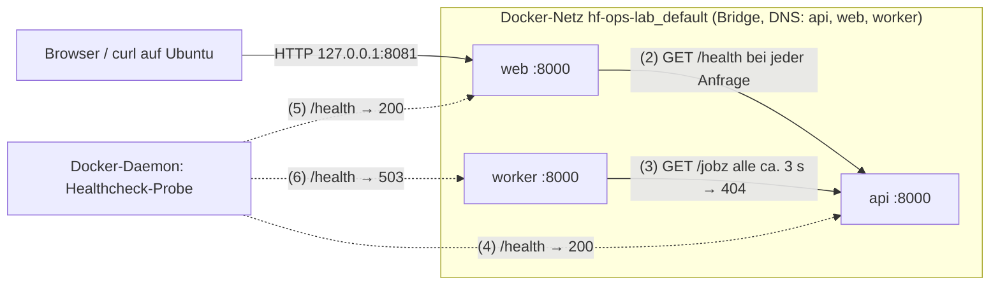

# Auftrag 2, Phase A: Statische Analyse der Startumgebung

| | |
| --- | --- |
| Name | Gian-Marco Rieder |
| Modul | HF Informatik, SAII, Local AI Engineering |
| Erstellt | 18.10.2026, 15:05 Uhr (CEST) |
| Stand | Vorhersage vor dem ersten `docker compose config`, Build oder Start (Phase B) |
| Methode | Alle Dateien aus `01_Startumgebung.zip` gelesen: README.md, compose.yaml, 3 × Dockerfile, 3 × .dockerignore, 3 × app.py. Python-Dateien nur syntaktisch geprüft (`ast.parse`, ohne Ausführung): alle gültig. Nichts verändert. |
| Git-Commit | (Hash nach dem Commit eintragen) |

### Analysierter Stand (SHA-256)

| Datei | SHA-256 |
| --- | --- |
| `01_Startumgebung.zip` | `f73436f3b750370ed44c34be0de6b16c756f48e6ff6cc500c38440d778d0cc51` |
| `compose.yaml` | `8234c271df505be86e75902999269ff457f468ff16d12bf40e79ee34992b94ea` |
| `api/Dockerfile`, `web/Dockerfile`, `worker/Dockerfile` (identisch) | `07f787b992aa0af259548a2a6283392b4436c82a874afe7fde6890a3fda86bb7` |
| `api/app.py` | `b65471a87aa4c2f3195c040fb6681fbb818f416c9f1b9b800ea1529fd1e266f0` |
| `web/app.py` | `d1d003aafcc52a04b935a4f2552857e470b7473190098983c40b90e791af7b64` |
| `worker/app.py` | `f948095a3de0d08a78e62eb7e02e8aea0565f2e6ee92c94e9118ae9ef74655a3` |
| `.dockerignore` (alle drei identisch) | `79603549bc2c133f6af1c824cf724ed414316ff8c0a3e88b3c0e114aa251f9e0` |

Zeilenangaben im Format `Datei:Zeile` beziehen sich auf genau diesen Stand.

---

## 1 Kurzfassung

- Compose-Projekt `hf-ops-lab` mit drei Python-Services (nur Standardbibliothek, kein Framework) im Standardnetz `hf-ops-lab_default` (Bridge).
- Nur `web` ist veröffentlicht: `127.0.0.1:8081 → 8000`, also nur auf Ubuntu selbst erreichbar. `api` und `worker` haben keinen Hostport.
- **Vorhersage:** `api` running/healthy, `web` running/healthy, `worker` running/**unhealthy** (ca. 20-25 s nach `up`).
- **Kernbefund:** `compose.yaml:44` setzt `JOB_PATH` auf `/jobz`, die API kennt nur `/jobs` (`api/app.py:9`). Der Worker erhält HTTP 404, fängt den Fehler ab und läuft weiter. Die Restart Policy greift deshalb nicht.
- **Risiko vor dem Start:** Die Dateien im ZIP sind mit Rechten `600` gespeichert. Bleibt das nach dem Entpacken so, kann UID 10001 `app.py` im Image nicht lesen (siehe H6).

---

## 2 Gemeinsame Basis aller drei Services

### 2.1 Dockerfile (für web, api und worker identisch)

| Zeile | Anweisung | Wirkung |
| --- | --- | --- |
| 1 | `FROM python:3.12-slim` | Debian-basiertes Python-Image ohne curl/wget. Nur per Tag, nicht per Digest festgelegt: ein späterer Build kann ein anderes Basisimage ziehen. |
| 2 | `ENV PYTHONDONTWRITEBYTECODE=1 PYTHONUNBUFFERED=1` | Keine `.pyc`-Dateien (passt zum read-only Dateisystem); Ausgaben erscheinen sofort in `docker logs`. |
| 3 | `WORKDIR /app` | Legt `/app` an, Eigentümer root. |
| 4 | `COPY app.py /app/app.py` | Einzige kopierte Datei. Eigentümer root:root, die Dateirechte werden aus dem Build-Kontext übernommen (siehe H6). |
| 5 | `USER 10001:10001` | Prozess läuft als UID/GID 10001, nicht als root. Kein Eintrag in `/etc/passwd`, `id` zeigt nur Zahlen. |
| 6 | `EXPOSE 8000` | Nur Dokumentation, veröffentlicht keinen Hostport. |
| 7 | `CMD ["python", "app.py"]` | Exec-Form: `python` ist direkt PID 1, ohne Shell und ohne Init-Prozess. |

`.dockerignore`: `__pycache__`, `*.pyc`, `.git`. Der Build-Kontext je Service enthält ohnehin nur Dockerfile, .dockerignore und app.py.

### 2.2 Compose-Einstellungen (für alle drei gleich)

| Einstellung | Zeilen api / web / worker | Wirkung |
| --- | --- | --- |
| `restart: unless-stopped` | 5 / 26 / 47 | Neustart bei Prozessende (jeder Exit-Code) und nach Neustart des Docker-Dienstes, ausser der Container wurde bewusst gestoppt. **Kein** Neustart bei `unhealthy`. |
| `read_only: true` | 6 / 27 / 48 | Root-Dateisystem schreibgeschützt, auch `/app/app.py` ist nicht veränderbar. |
| `cap_drop: [ALL]` | 7 / 28 / 49 | Alle Linux-Capabilities entfernt (auch Bounding Set). Port 8000 liegt über 1024 und braucht keine. |
| `security_opt: no-new-privileges:true` | 8 / 29 / 50 | Keine Rechteausweitung über setuid/setgid-Programme. |
| `tmpfs: /tmp:size=8m,mode=1777` | 9 / 30 / 51 | Einziger beschreibbarer Ort: 8 MB im RAM, flüchtig, nach jedem Containerneustart leer. |
| `logging: json-file, max-size 2m, max-file 2` | 10-12 / 31-33 / 52-54 | Höchstens ca. 4 MB Log je Container. Logs gehören zum Container und verschwinden mit `down` oder Neuerstellung. |
| `healthcheck` | 13-18 / 34-39 / 55-60 | Siehe 2.3 |

Nicht vorhanden: `volumes`, eigener `networks`-Abschnitt (daher Standardnetz), Ressourcenlimits, `init`, `user`-Override.

### 2.3 Healthcheck: Mechanik und Zeitverhalten

Docker führt **im jeweiligen Container** aus:

```bash
python -c "import urllib.request; urllib.request.urlopen('http://127.0.0.1:8000/health', timeout=2)"
```

- `127.0.0.1` ist dabei der Container selbst, nicht der Ubuntu-Host.
- `urlopen` wirft bei Verbindungsfehler, Timeout **und** bei HTTP-Status ab 400 eine Exception. Dann endet Python mit Exit-Code 1 und die Probe gilt als fehlgeschlagen. Nur 2xx/3xx ergibt Exit-Code 0.
- Python statt curl ist korrekt gewählt, weil `python:3.12-slim` kein curl enthält.

Zeitverhalten mit `interval 5s`, `timeout 3s`, `retries 3`, `start_period 5s`:

- Erste Probe ca. 5 s nach Containerstart, bis dahin Status `starting`.
- Ein erster Erfolg setzt sofort `healthy`.
- Fehlschläge in den ersten 5 s zählen nicht. Danach führen 3 Fehlschläge in Folge zu `unhealthy`, also ca. 15-20 s nach Containerstart.
- Docker **markiert** den Zustand nur. Ohne Swarm wird ein unhealthy Container weder neu gestartet noch gestoppt.

---

## 3 Steckbriefe

### 3.1 api

| Kriterium | Befund | Beleg |
| --- | --- | --- |
| Base Image, Dateien, Start, Prozess | `python:3.12-slim`; nur `app.py` → `/app/app.py`; Start mit `python app.py`; ein Prozess (PID 1) mit `ThreadingHTTPServer` (ein Thread pro Anfrage). | `api/Dockerfile:1,4,7`; `api/app.py:20-21` |
| Benutzer, Dateisystem, Capabilities, Schutz | UID/GID 10001; Root-FS read-only, nur `/tmp` (tmpfs 8 MB) beschreibbar; keine Capabilities; no-new-privileges; Log-Rotation. | `api/Dockerfile:5`; `compose.yaml:6-12` |
| Ports, Bind-Adresse, Verbindungen | Lauscht im Container auf `0.0.0.0:8000`. **Kein Hostport** (kein `ports:`). Eingehend: web (`GET /health`), worker (`GET /jobz`), eigene Docker-Probe über 127.0.0.1. Ausgehend: keine, der Code stellt selbst keine Anfragen. | `api/app.py:21`; `compose.yaml:3-18` |
| Environment | Compose setzt keine Variablen, der Code liest keine. Routen fest im Code: `/health` → 200; `/jobs` → 200 mit Job `demo-001` und aktueller UTC-Zeit; alles andere → 404 mit `valid_routes: ["/health", "/jobs"]`. Exakter Stringvergleich: auch `/jobs/` oder `/jobs?x=1` ergeben 404. Nur GET implementiert. | `api/app.py:7-12` |
| Persistenz | Keine. Der Job ist statisch, nur `time` wird pro Anfrage neu berechnet. Bei Neuerstellung bleibt nur das Image (Code), keine Daten. | `api/app.py:10`; `README.md:12` |
| Healthcheck | Probe auf `/health` liefert immer 200, solange der Server antwortet. Geprüft wird nur die Erreichbarkeit (Liveness), **nicht**, ob `/jobs` funktioniert. Ein Fehler wird sichtbar, wenn der Prozess hängt oder nicht lauscht: nach 3 Fehlschlägen, ca. 15 s. | `compose.yaml:13-18`; `api/app.py:7-8` |
| Startabhängigkeit, Restart | Keine Abhängigkeit, startet zuerst. `unless-stopped`. web und worker warten auf api `service_healthy`. | `compose.yaml:5,24-25,45-46` |
| Erwarteter Zustand nach Start | `running`, `healthy` nach ca. 5 s. Zugriffslog (stderr, von `BaseHTTPRequestHandler`): `"GET /health HTTP/1.1" 200` von 127.0.0.1 (Probe) und von der web-IP, ausserdem alle ca. 3 s `"GET /jobz HTTP/1.1" 404` von der worker-IP. | `api/app.py:7-12` |

### 3.2 web

| Kriterium | Befund | Beleg |
| --- | --- | --- |
| Base Image, Dateien, Start, Prozess | `python:3.12-slim`; nur `app.py`; `python app.py`; ein Prozess (PID 1) mit `ThreadingHTTPServer`. | `web/Dockerfile:1,4,7`; `web/app.py:25-26` |
| Benutzer, Dateisystem, Capabilities, Schutz | UID/GID 10001; Root-FS read-only, nur `/tmp` beschreibbar; keine Capabilities; no-new-privileges; Log-Rotation. | `web/Dockerfile:5`; `compose.yaml:27-33` |
| Ports, Bind-Adresse, Verbindungen | `127.0.0.1:8081 → 8000`: nur über Ubuntu-Loopback erreichbar, nicht aus dem LAN/von Kali. Im Container `0.0.0.0:8000` (nötig, damit die Docker-Weiterleitung den Server erreicht). Eingehend: Browser/curl auf Ubuntu, Docker-Probe. Ausgehend: bei **jeder** Anfrage auf `/` oder `/health` ein `GET http://api:8000/health` (Timeout 2 s), Namensauflösung über den Docker-DNS. | `compose.yaml:21`; `web/app.py:10,26` |
| Environment | `API_URL`: Compose `http://api:8000`, Code-Default `http://api:8000`. Identisch, keine Abweichung. | `compose.yaml:23`; `web/app.py:3` |
| Persistenz | Keine. Der Status wird bei jeder Anfrage neu ermittelt. | `web/app.py:9-14` |
| Healthcheck | Kette: Docker-Probe → web `/health` → api `/health`. web ist healthy, wenn die API gültiges JSON liefert; sonst HTTP 503 mit `api unavailable`. **Der Worker wird nicht geprüft:** web bleibt healthy, obwohl der Worker defekt ist. Fällt die API aus, wird auch web nach ca. 15 s unhealthy. | `compose.yaml:34-39`; `web/app.py:9-16` |
| Startabhängigkeit, Restart | `depends_on: api: condition: service_healthy`: web wird erst erstellt, wenn api healthy ist. Das gilt nur bei `docker compose up`; der Docker-Dienst beachtet diese Reihenfolge bei automatischen Neustarts (z. B. nach Reboot) nicht. `unless-stopped`. | `compose.yaml:24-26` |
| Erwarteter Zustand nach Start | `running`, `healthy` ca. 5 s nach seinem Start (ca. 10 s nach `up`). `curl -fsS http://127.0.0.1:8081/health` → `{"status": "healthy", "service": "web"}`. `/` liefert HTML mit `Web: healthy`. Andere Pfade → 404, HEAD (`curl -I`) → 501. | `web/app.py:7-8,12,15-20` |

### 3.3 worker

| Kriterium | Befund | Beleg |
| --- | --- | --- |
| Base Image, Dateien, Start, Prozess | `python:3.12-slim`; nur `app.py`; `python app.py`. Ein Prozess mit zwei Threads: Hintergrund-Thread `work()` (Endlosschleife, Daemon) und HTTP-Server für `/health` im Hauptthread. | `worker/Dockerfile:1,4,7`; `worker/app.py:8-20,33-35` |
| Benutzer, Dateisystem, Capabilities, Schutz | UID/GID 10001; Root-FS read-only, nur `/tmp` beschreibbar; keine Capabilities; no-new-privileges; Log-Rotation. | `worker/Dockerfile:5`; `compose.yaml:48-54` |
| Ports, Bind-Adresse, Verbindungen | Lauscht auf `0.0.0.0:8000`, **kein Hostport**: `/health` ist nur im Container bzw. im Compose-Netz erreichbar. Eingehend: Docker-Probe. Ausgehend: alle ca. 3 s `GET API_URL + JOB_PATH` (Timeout 2 s). | `worker/app.py:11,20,35`; `compose.yaml:40-60` |
| Environment | `API_URL`: Compose `http://api:8000` = Code-Default. **`JOB_PATH`: Compose `${JOB_PATH:-/jobz}` → effektiv `/jobz`, Code-Default `/jobs`.** Der Compose-Wert überschreibt den Code-Default. Auflösung: Shell-Variable beim Compose-Aufruf vor `.env`-Datei im Projektordner vor Default `/jobz`. | `compose.yaml:43-44`; `worker/app.py:3-4` |
| Persistenz | Keine. `last_success` und `last_error` liegen nur im RAM; bei jedem Prozessstart wieder `last_error = 'no successful job yet'`. | `worker/app.py:5` |
| Healthcheck | `/health` ist nur ok, wenn der letzte Erfolg weniger als 12 s zurückliegt **und** `last_error` leer ist, sonst 503 mit Fehlertext. Damit wird die fachliche Funktion geprüft (echter Jobabruf). Da nie ein Erfolg eintritt, antwortet `/health` von Anfang an mit 503. Nach Start-Periode und 3 Fehlschlägen: `unhealthy`. | `worker/app.py:26-29`; `compose.yaml:55-60` |
| Startabhängigkeit, Restart | `depends_on: api: condition: service_healthy`, `unless-stopped`. Der Fehler beendet den Prozess nicht (Exception wird abgefangen), deshalb greift die Restart Policy nicht: RestartCount bleibt 0. | `compose.yaml:45-47`; `worker/app.py:16-20` |
| Erwarteter Zustand nach Start | `running`, `unhealthy` ca. 15-20 s nach Workerstart (ca. 20-25 s nach `up`). Log alle ca. 3 s: `ERROR job fetch failed path=/jobz: HTTP Error 404: Not Found`, dazwischen alle 5 s die Probe `"GET /health HTTP/1.1" 503`. Health-Antwort: `{"status": "unhealthy", "error": "HTTP Error 404: Not Found"}`. | `worker/app.py:17-19,28-29`; `api/app.py:11-12` |

---

## 4 Datenfluss



| Nr. | Von | Nach | Anfrage | Häufigkeit | Erwartete Antwort |
| --- | --- | --- | --- | --- | --- |
| 1 | Browser/curl (Ubuntu) | web über `127.0.0.1:8081` | `GET /` oder `/health` | manuell | 200, solange die API antwortet |
| 2 | web | `api:8000` | `GET /health` | pro Anfrage aus 1 und 5 | 200 JSON |
| 3 | worker | `api:8000` | `GET /jobz` | alle ca. 3 s | **404** |
| 4 | Docker-Probe | api (intern 127.0.0.1) | `GET /health` | alle 5 s | 200 |
| 5 | Docker-Probe | web (intern 127.0.0.1) | `GET /health`, löst 2 aus | alle 5 s | 200 |
| 6 | Docker-Probe | worker (intern 127.0.0.1) | `GET /health` | alle 5 s | **503** |

Nicht Teil des Stacks: Ollama (`127.0.0.1:8080`) und Open WebUI (Port 3000). Port 8081 kollidiert nicht damit. Da `127.0.0.1` im Bridge-Container den Container selbst bezeichnet, erreichen diese Services das lokal gebundene Ollama nicht (relevant für Phase D).

---

## 5 Konfigurationsabweichung zwischen API und Aufrufer

| Stelle | Wert |
| --- | --- |
| Angebotene Route, `api/app.py:9` | `/jobs` |
| Code-Default des Workers, `worker/app.py:4` | `/jobs` |
| Laufzeitkonfiguration, `compose.yaml:44` | `${JOB_PATH:-/jobz}` → **`/jobz`** |
| Resultierende Anfrage, `worker/app.py:11` | `http://api:8000/jobz` |
| Antwort der API, `api/app.py:11-12` | 404 `{"error": "route not found", "valid_routes": ["/health", "/jobs"]}` |

Der Code für sich wäre korrekt; erst die Compose-Konfiguration erzeugt den Fehler (ein Zeichen: `z` statt `s`). Die API nennt die gültigen Routen im 404-Body, der Worker loggt aber nur `str(exc)` und nicht den Body (`worker/app.py:17-19`).

Ohne Abweichung geprüft:

- `API_URL` von web und worker = `http://api:8000` = Servicename `api` + Bind-Port 8000 der API.
- Alle Healthchecks prüfen Port 8000 = Bind-Port aller drei Apps.
- web: Hostport 8081 → Containerport 8000 = Bind-Port.

---

## 6 Prüfbare Hypothesen (vorerst nichts geändert)

### H1 Hauptfehler: falscher Jobpfad

**Hypothese:** Weil `compose.yaml:44` `JOB_PATH=/jobz` setzt und die API nur `/jobs` kennt, erhält der Worker bei jedem Abruf HTTP 404. Der Prozess läuft weiter, der Healthcheck schlägt fehl: worker `running` / `unhealthy`, RestartCount 0.

**Prüfung in Phase B:**

```bash
sudo docker compose config | grep -n JOB_PATH            # erwartet: JOB_PATH: /jobz
sudo docker compose ps -a                                # worker: Up ... (unhealthy)
sudo docker compose logs -t --tail 20 worker             # ERROR job fetch failed path=/jobz: HTTP Error 404: Not Found
sudo docker compose logs -t --tail 50 api | grep jobz    # "GET /jobz HTTP/1.1" 404
sudo docker inspect --format '{{.RestartCount}} {{.State.Health.Status}}' \
  "$(sudo docker compose ps -q worker)"                  # erwartet: 0 unhealthy
```

**Gegenprobe** (gleicher Abruf mit korrektem Pfad aus dem Worker-Container; belegt, dass Netz, DNS und API funktionieren):

```bash
sudo docker compose exec -T worker python -c "import urllib.request; print(urllib.request.urlopen('http://api:8000/jobs', timeout=2).read().decode())"
```

Erwartet: JSON mit `"job": "demo-001"`.

**Widerlegt, wenn:** die Logs statt `HTTP Error 404` einen Verbindungsfehler zeigen (`Connection refused`, `Name or service not known`, `timed out`). Dann liegt ein Netz-, DNS- oder API-Problem vor, nicht der Pfad. Ebenso, wenn `config` bereits `/jobs` ausgibt (z. B. wegen einer `.env`-Datei).

**Kleinste Reparatur (erst in Phase E, Schritt 4):** Compose-Default auf `${JOB_PATH:-/jobs}` ändern und den Worker neu erstellen (`sudo docker compose up -d worker`). Erwartet danach: `INFO processed job=demo-001` alle ca. 3 s, Worker innerhalb von ca. 5-10 s healthy, in den API-Logs `"GET /jobs HTTP/1.1" 200`.

### H2 web ist healthy trotz defektem Worker

web prüft nur die API (`web/app.py:10`). Erwartet: `curl -fsS http://127.0.0.1:8081/health` liefert `healthy`, während der Worker unhealthy ist. Ein grüner web-Status sagt nichts über den Worker aus.

### H3 Die Restart Policy greift bei unhealthy nicht

Docker startet Container nur bei Prozessende neu, nicht bei `unhealthy`. Erwartet: RestartCount des Workers bleibt 0, die Container-ID bleibt gleich, die Laufzeit (`Up ...`) wächst weiter.

### H4 `restart` übernimmt keine geänderten Variablen, `sudo` verwirft exportierte Variablen

`docker compose restart` startet denselben Container mit der alten Konfiguration. Eine geänderte Variable wirkt erst durch Neuerstellung (`up -d`). Zudem setzt `sudo` unter Ubuntu die Umgebung standardmässig zurück (`env_reset`): Nach `export JOB_PATH=/jobs` zeigt `sudo docker compose config` weiterhin `/jobz`. Wirksam wäre `sudo env JOB_PATH=/jobs docker compose ...` oder eine `.env`-Datei im Projektordner.

Prüfung: `export JOB_PATH=/jobs; sudo docker compose config | grep JOB_PATH` → erwartet weiterhin `/jobz`.

### H5 Stoppen dauert ca. 10 s pro Container

`python` läuft als PID 1 ohne eigenen SIGTERM-Handler. Linux stellt PID 1 eines Namespaces nur Signale zu, für die ein Handler existiert (Ausnahme SIGKILL). `docker stop` wartet deshalb die Standardfrist von 10 s ab und beendet dann mit SIGKILL. Erwartet: `time sudo docker compose stop` dauert ca. 20 s (web und worker parallel, danach api), Exit-Code 137 (`docker inspect --format '{{.State.ExitCode}}'`). Nicht Teil des eigentlichen Fehlers, aber relevant für die Ausfall- und Restarttests.

### H6 Risiko vor dem Start: Dateirechte 600 aus dem ZIP

Im ZIP sind alle Dateien mit `-rw-------` (600) gespeichert. `unzip` übernimmt diese Rechte (nachvollzogen auf einem Linux-System mit umask 022: Ergebnis 600). `COPY` übernimmt die Dateirechte, Eigentümer wird root. UID 10001 könnte `/app/app.py` dann nicht lesen.

**Vorhersage, falls die Dateien auf Ubuntu 600 haben:** Die Container enden sofort mit `python: can't open file '/app/app.py': [Errno 13] Permission denied` (Exit-Code 2) und starten wegen `unless-stopped` immer wieder neu. api wird nie healthy, web und worker werden nicht gestartet bzw. `compose up` bricht mit einem Abhängigkeitsfehler ab. Das wäre **nicht** der beabsichtigte Worker-Fehler.

**Statische Prüfung vor dem Build** (im Ordner `01_Startumgebung`):

```bash
stat -c '%a %U %n' */app.py
```

Bei `600` die Abweichung dokumentieren und nur die Leserechte ergänzen (`chmod 644 */app.py`). Inhalt und SHA-256-Werte bleiben dabei unverändert.

### Weitere Vorhersagen (für Phase E)

| Situation | Erwartung | Beleg |
| --- | --- | --- |
| API gestoppt | web nach ca. 15 s unhealthy, `/` und `/health` → 503 `api unavailable`. Worker-Log wechselt von `HTTP Error 404` zu einem Verbindungs- oder DNS-Fehler (`<urlopen error ...>`). | `web/app.py:13-14`; `worker/app.py:16-19` |
| Worker repariert, danach API kurz weg | Worker wird unhealthy und erholt sich ohne Neustart, sobald die API wieder antwortet. | `worker/app.py:9-20` |
| `docker compose down` | Container, Netz und Logs entfernt; Images bleiben. Keine fachlichen Daten gehen verloren, weil keine existieren. | keine Volumes |

---

## 7 Erwarteter Ablauf nach `docker compose up -d --build`

| Zeit ab `up` (ca.) | Ereignis |
| --- | --- |
| 0 s | Images bauen, Netz `hf-ops-lab_default` anlegen, api starten (`health: starting`). |
| 5 s | Erste Probe der api erfolgreich → `healthy`. Compose erstellt und startet web und worker. Der `up`-Befehl kehrt danach zurück. |
| 5 s | Worker loggt sofort die ersten 404-Fehler. |
| 10 s | web `healthy`. |
| 20-25 s | worker `unhealthy` (FailingStreak mindestens 3). |

Erwartete Ausgabe von `sudo docker compose ps -a` (Schema):

```text
NAME                  SERVICE   STATUS                 PORTS
hf-ops-lab-api-1      api       Up ... (healthy)       8000/tcp
hf-ops-lab-web-1      web       Up ... (healthy)       127.0.0.1:8081->8000/tcp
hf-ops-lab-worker-1   worker    Up ... (unhealthy)     8000/tcp
```

Erwartete Health-Details des Workers (`docker inspect --format '{{json .State.Health}}'`): `"Status":"unhealthy"`, steigender `FailingStreak`, Log-Einträge mit `"ExitCode":1` und einem Traceback, der mit `urllib.error.HTTPError: HTTP Error 503: Service Unavailable` endet.

**Hinweis zu Zeitstempeln:** Die ERROR-Zeilen des Workers enthalten keinen eigenen Zeitstempel, für Belege deshalb `docker compose logs -t` verwenden. Die Zugriffslogs von `http.server` verwenden die Containerzeit UTC (aktuell Schweizer Zeit minus 2 h, ab 25.10.2026 minus 1 h).

---

## 8 Warum ein laufender Prozess keine funktionierende Anwendung bedeutet

Docker meldet `running`, solange PID 1 existiert. Beim Worker ist das dauerhaft der Fall: Die Endlosschleife fängt jede Exception ab (`worker/app.py:16`), schreibt eine Logzeile und versucht es nach 3 s erneut; der HTTP-Server im Hauptthread antwortet weiterhin. Der Prozess lebt, verarbeitet aber keinen einzigen Job.

Es gibt drei Ebenen, die getrennt betrachtet werden müssen:

1. **Prozess läuft** (`running`): sagt nur, dass der Prozess existiert.
2. **Dienst antwortet** (Port offen, `/health` erreichbar): Liveness. So ist die API geprüft; ihr `/health` liefert immer 200, selbst wenn `/jobs` defekt wäre.
3. **Fachliche Funktion erfüllt** (Job wird abgerufen und verarbeitet): Erst der Worker-Healthcheck prüft das über `last_success` und `last_error`.

Daraus folgt: Ein Healthcheck ist nur so aussagekräftig wie das, was er prüft. web prüft z. B. nur die API, nicht den Worker. Ausserdem reagiert Docker auf `unhealthy` nicht automatisch, die Restart Policy greift nur bei Prozessende. Ein Neustart würde hier auch nichts nützen, weil die fehlerhafte Konfiguration gleich bleibt. Erkennbar wird der Fehler erst durch die Kombination von Prozesszustand, Health und Logs, also genau das, was das Dashboard in Phase C getrennt anzeigen muss.

---

## 9 Nebenbefunde (ohne Änderung)

- Basisimage nur per Tag, nicht per Digest festgelegt: eingeschränkte Reproduzierbarkeit.
- Kein Init-Prozess (`init: true` fehlt), siehe H5.
- Keine Ressourcenlimits (Speicher, CPU, PIDs).
- Das Standard-Bridge-Netz ist nicht `internal`: Die Container hätten Internetzugang, obwohl keiner ihn braucht. Innerhalb des Netzes sind alle Ports aller Services gegenseitig erreichbar.
- Unveröffentlichte Ports (api, worker) sind über keinen Hostport erreichbar, vom Ubuntu-Host selbst aber grundsätzlich über die Container-IP im Bridge-Netz. "Kein `ports:`" heisst nicht "nicht erreichbar".
- Der Worker loggt den 404-Body (`valid_routes`) nicht; die Ursache ist deshalb nur mit Code oder manuellem Abruf eindeutig.
- Exakter Pfadvergleich in allen drei Apps, nur GET implementiert (HEAD und POST → 501).
- `depends_on` wirkt nur beim Start durch Compose. Fällt die API später aus, werden web und worker nicht gestoppt. Nach einem Neustart des Docker-Dienstes starten alle drei ohne Reihenfolge.

---

## 10 Checkpoint A

Diese Vorhersage ist vor dem ersten Start gespeichert (Zeitstempel und Git-Commit oben). Der Abgleich mit der Realität (Zustand, Health, Logzeilen mit Zeitstempel; Beobachtung, Vermutung und Beweis getrennt) folgt in Phase B.
